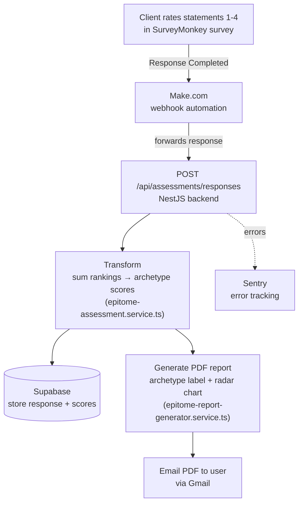

# Epitome Assessment Automation

Automates the Epitome Archetype assessment: takes a completed SurveyMonkey response, calculates the respondent's leading archetype, generates a personalized PDF report with a radar chart, and emails it — no manual scoring or report-building.

## How It Works



## Make.com Automation Workflow

The assessment automation is triggered and orchestrated by Make.com, which bridges SurveyMonkey responses to your backend processing and email delivery.

### Workflow Overview

```
┌─────────────────────────────────────────────────────────────────┐
│                      Make.com (Orchestration)                   │
│                                                                 │
│  1. Survey Monkey Webhook                                      │
│     └─ Triggers instantly when response is submitted           │
│                                                                 │
│  2. Get Response                                                │
│     └─ Extracts full response data from SurveyMonkey          │
│        (name, email, organization, all rankings)              │
│                                                                 │
│  3. HTTP POST to Backend                                        │
│     └─ POST https://epitome-automation.vercel.app             │
│        /api/assessments/responses                              │
│        (with bearer token authentication)                      │
└─────────────────────────────────────────────────────────────────┘
                              │
                       HTTP POST request
                              ▼
┌─────────────────────────────────────────────────────────────────┐
│                 Assessment Service API                          │
│                                                                 │
│  4. Receive & Validate                                          │
│     └─ Verify authentication and required fields               │
│                                                                 │
│  5. Transform & Score                                           │
│     └─ Sum rankings per archetype, determine leading type      │
│                                                                 │
│  6. Store Response                                              │
│     └─ Save raw data and calculated scores to database         │
│                                                                 │
│  7. Generate PDF Report                                         │
│     └─ Create customized PDF with user info and radar chart    │
│                                                                 │
│  8. Send Email                                                  │
│     └─ Attach PDF and deliver to user via Gmail               │
│                                                                 │
│  9. Error Handling                                              │
│     └─ Log all errors to Sentry and alert on failures         │
└─────────────────────────────────────────────────────────────────┘
                              │
                              ▼
                          Gmail (via SMTP)
                              │
                              ▼
                    User receives email
                       with PDF report
```

### Why This Architecture?

Make.com acts as the **trigger and delivery coordinator** — it waits for the survey response, then hands it off to your backend to handle all the complex logic: scoring, PDF generation, error handling, and database storage.

**Benefits:**
- **Separation of concerns**: Make handles integrations (SurveyMonkey ↔ your API); backend handles business logic
- **Decoupled from SurveyMonkey**: If SurveyMonkey changes their API, you only update the Make workflow, not your code
- **Scalable**: Backend can process assessments from multiple sources (not just SurveyMonkey)
- **Observable**: Errors logged to Sentry; Make orchestration visible in Make's UI

### Make Configuration

The workflow is configured with:
- **Authentication**: Bearer token (`real_epitome_bearer_token` secret)
- **Headers**: `Content-Type: application/json`, `Authorization: Bearer <token>`
- **Execution**: "Immediately as data arrives" — triggers the instant a SurveyMonkey response completes

## Core Concepts

### Survey Ranking System

**Critical:** The 1-4 ranking scale is the foundation of all calculations.

- Users rank 4 statements per question
- **1 = "Fully describes me"** (highest weight)
- **4 = "Does not describe me at all"** (lowest weight)
- Each statement is associated with an archetype (Sovereign, Empress, Consort, Seductress)
- On the radar chart a ranking of 1 is drawn on the **outer** ring and 4 on the inner ring, so the archetype that most describes the user appears largest

### Data Processing Flow

1. User rates statements 1-4 in SurveyMonkey
2. SurveyMonkey sends the response to Make via a webhook (an automatic notification sent the instant the survey is completed, rather than Make having to repeatedly check for new responses)
3. Make forwards the response to the `/api/assessments/responses` endpoint
4. **Transform** (`EpitomeAssessmentService.transformResponse()`): Raw data is converted into a structured response, and archetype scores are calculated by summing rankings — the **lowest score is the leading archetype**
   - If two archetypes land within 2 points of the lowest score, both are shown together as the leading archetype (e.g. "Sovereign and Empress")
5. **Store** (`SupabaseService.insertSurveyResponse()`): Rankings are saved to Supabase **exactly as received** (1 stays 1, 4 stays 4), along with the calculated archetype scores
6. **Generate Report** (`EpitomeReportGeneratorService.createCustomisedReport()`): Create customized PDF with user name, leading archetype label, and radar chart visualization of scores
7. **Send Email** (`EpitomeAssessmentService.sendEmailReportWithRetry()`): Deliver PDF to user via Gmail. The send is awaited (on serverless the function ends with the response), retried once after a short delay, and never retried on a credential rejection. A failure is logged with the SMTP code and response and reported as `email_sent: false` in the API body; the stored response still returns 201.

**Key Files:**
- `src/epitome-assessment/epitome-assessment.service.ts` — Transforms survey data and orchestrates the processing pipeline
- `src/epitome-assessment/epitome-assessment.controller.ts` — Handles `/api/assessments/responses` endpoint and token validation
- `src/epitome-assessment/epitome-report-generator.service.ts` — Generates customized PDF reports with the user's archetype, personal information, and their radar chart
- `src/db-supabase/supabase.service.ts` — Database operations for storing and retrieving responses
- `src/epitome-assessment/archetype-label.ts` — The single `getArchetypeLabel()` used by both the API response and the PDF, so they can never disagree
- `src/config/questions_map.json` — Maps each of the 12 survey questions to dimensions, and links each answer statement to its archetype (Sovereign, Empress, Consort, Seductress)

## Repo Layout

| Path | Purpose |
|---|---|
| `src/` | NestJS application source (controllers, services, config) |
| `tests/` | Integration tests (real PDF generation) and Playwright e2e tests |
| `CLAUDE.md` | Project rules for AI-assisted development |
| `.ai/` | AI-assisted dev workflow scaffold (rules, skills, docs) |

## Getting Started

**Prerequisites:** Node.js, a Supabase project, Gmail app password, Sentry DSN (optional).

1. Copy `.env.example` to `.env` and fill in `SUPABASE_URL`, `SUPABASE_API_KEY`, `EPITOME_AUTOMATION_SECRET`, `SENTRY_DSN`, `GMAIL_USER`, `GMAIL_APP_PASSWORD`, `PORT`
2. `npm install`
3. `npm run start:dev` — runs the API locally with hot reload
4. `npm test` — unit + integration tests
5. `npm run test:e2e` — hits the live endpoint, Supabase, and Gmail (sends real emails to fixture addresses)

## Credentials & Monitoring

**Sentry Error Tracking:** All errors (auth failures, timeouts, connection issues, data validation) are automatically captured and sent to Sentry. You'll receive email alerts for any errors, so you don't need to manually monitor logs. Check your Sentry dashboard for error details tagged by phase (`email_auth_failure`, `report_generation`, `database_insert`, etc.).

**Gmail App Password:** Google revokes app passwords if unused for 60 days. If email delivery stops, regenerate the app password in your Google Account security settings (`myaccount.google.com/apppasswords`), then update `GMAIL_APP_PASSWORD` in your deployment environment. Auth failures will appear in Sentry with tag `phase: email_auth_failure` and you'll receive an email alert.

## Database Schema

The `survey_responses` table stores everything captured from a submission:
- `response_id`, `survey_id`
- `created_at` — when the row was saved to Supabase
- `date_created` — when the user actually completed the survey in SurveyMonkey
- `first_name`, `last_name`, `email`, `organization`
- `ip_address`, `duration_seconds`, `collector_id`, `response_status`
- `archetype_scores`: `{ Sovereign: X, Empress: Y, Consort: Z, Seductress: W }`
- `responses`: The user's responses to each of the 12 survey questions, including the statement, its archetype, and the ranking given

**Note:** `archetype_label` is **not** stored in the database. It's calculated on the fly by `getArchetypeLabel()` in `src/epitome-assessment/archetype-label.ts`, both for the API response and each time a PDF report is generated.

## Data Integrity

Reports are never generated from default or placeholder data. If a response is missing rankings, archetype scores, or anything else the chart or label needs, generation throws and no email is sent. See the Data Integrity rule in `CLAUDE.md`.

## Tests

- `src/epitome-assessment/*.spec.ts` — unit tests; `epitome-report-chart.spec.ts` parses the real SVG and checks every point sits at the radius its ranking demands
- `tests/report-generation.spec.ts` — raw survey DTO → real PDF with `sharp` and `pdf-lib`, only Supabase stubbed
- `tests/survey-submission.e2e.spec.ts` — hits the live endpoint, Supabase and Gmail; sends one email per fixture (`npm run test:e2e`)
- `tests/fixtures/e2e-survey-response.ts` — the shared survey fixtures with their expected per-dimension rankings, totals and labels

## Tech Stack

NestJS · TypeScript · Supabase · Sentry · `pdf-lib` + `sharp` (PDF/image generation) · Jest + Playwright (testing)
